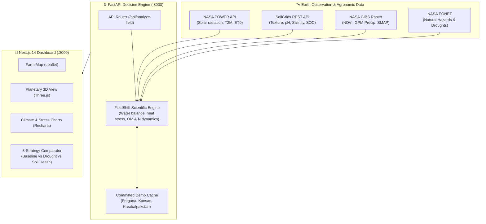

# Field Shift UZ: Adapting Farms with NASA Data

[](https://github.com/wlkcsh/nasa-apps-challenge/actions/workflows/ci.yml)
[](https://fastapi.tiangolo.com)
[](https://nextjs.org/)
[](https://www.python.org/)
[](https://www.typescriptlang.org/)
[](./LICENSE)
[](https://www.spaceappschallenge.org/)

> An intelligent, farmer-centered decision-support system built for the **NASA Space Apps Challenge 2026**.  
> Fuses NASA Earth observations with regional agronomic parameters to empower farmers to explore resilient crop rotations, conserve water, and restore soil capital.

---

## 🚀 Overview

Agricultural systems worldwide face intensifying climatic volatility: unpredictable precipitation, prolonged heatwaves, and soil degradation. **Field Shift UZ** translates multi-decade NASA Earth observations into actionable, field-level recommendations for crop rotations.

Rather than acting as an opaque automated planner, **Field Shift UZ** operates on the core principle of **"Support, Never Replace"**:
* Evaluates the grower's **historical baseline rotation** side-by-side with at least **two climate-adaptive alternatives** (e.g., water-saving drought-resilient crops and soil-regenerative nitrogen-fixing rotations).
* Quantifies seasonal vulnerabilities: identifies windows when fields sit bare, predicts heat stress spikes, and tracks root-zone moisture deficits.
* Communicates transparent rationale, empirical satellite evidence, benefits, data limitations, and local agronomic risks.

---

## 📚 Challenge Documentation

Comprehensive challenge specifications extracted from the official NASA Space Apps Challenge portal are stored in the [`challenge/`](./challenge/) directory:

* 📄 [**Challenge Overview & Index**](./challenge/README.md)
* 📄 [**01. Background & Objectives**](./challenge/01-background-and-objectives.md) — Problem context, multigenerational farming inspiration, and mission objectives.
* 📄 [**02. Rotation Strategies & Requirements**](./challenge/02-rotation-strategies-and-requirements.md) — 3-strategy comparison rules, vulnerability detection, and UX directives.
* 📄 [**03. NASA & Partner Datasets**](./challenge/03-nasa-and-partner-datasets.md) — Inventory of 20+ satellite missions (NASA POWER, SMAP, GPM, ECOSTRESS, Landsat, SRTM, Sentinel-2, ERA5, SSURGO).

Detailed engineering specifications and component layouts are documented in [**`ARCHITECTURE.md`**](./ARCHITECTURE.md).

---

## 🛠️ Architecture & Tech Stack



### Directory Structure

```text
nasa-apps-challenge/
├── challenge/                  # Official NASA Space Apps challenge documentation
│   ├── README.md               # Master challenge index
│   ├── 01-background-and-objectives.md
│   ├── 02-rotation-strategies-and-requirements.md
│   └── 03-nasa-and-partner-datasets.md
├── ARCHITECTURE.md             # Complete technical blueprint and API contracts
├── backend/                    # Python FastAPI decision engine
│   ├── main.py                 # API router & endpoints
│   ├── models.py               # Pydantic schemas for requests/responses
│   ├── fieldshift/             # Self-contained scientific agronomic & satellite pipeline
│   ├── services/
│   │   ├── nasa_eonet.py       # NASA EONET natural disaster hazard tracker
│   │   ├── nasa_power.py       # NASA POWER API client & climatology parser
│   │   └── rotation_engine.py  # Multi-criteria agronomic evaluation engine
│   ├── data/
│   │   ├── demo_cache/         # Pre-cached NASA POWER & SoilGrids offline data
│   │   └── fallback_presets.json # Offline regional presets (Tashkent, Samarkand, Fergana, etc.)
│   └── tests/                  # Automated pytest test suite
│       ├── conftest.py
│       └── test_api.py
├── frontend/                   # Next.js 14 + React Three Fiber + Tailwind CSS web application
│   └── src/
│       ├── app/page.tsx        # Main dashboard
│       └── components/
│           ├── FarmMap.tsx     # Leaflet geospatial farm selector
│           ├── ClimateCharts.tsx # Environmental stress & seasonal trends
│           ├── RotationTimeline.tsx # Side-by-side 3-strategy rotation comparator
│           └── AralSitesWheel.tsx # Aral Sea ecological telemetry wheel
├── presentation/               # Keynote pitch decks (.pptx) and deckcraft scripts
├── prototypes/                 # Standalone 3D and satellite visual prototypes
└── start.sh                    # One-command bootstrap (uv + pnpm)
```

---

## ⚡ Quick Start

### 1. Prerequisites
* **Node.js** (v18+) & **pnpm**
* **Python** (v3.10+) with `uv` (recommended) or `pip`

### 2. Launching Locally (One Command)
Run the full application (concurrently launching FastAPI on port 8000 and Next.js on port 3000):

```bash
chmod +x start.sh
./start.sh
```

Or start the services individually:

**Backend:**
```bash
cd backend
# With uv (recommended):
uv venv .venv
uv pip install -r requirements.txt
uv run uvicorn main:app --reload --port 8000

# Or standard pip:
python3 -m venv .venv
source .venv/bin/activate
pip install -r requirements.txt
uvicorn main:app --reload --port 8000
```

**Frontend:**
```bash
cd frontend
pnpm install
pnpm dev
```

Visit [http://localhost:3000](http://localhost:3000) to view the interactive dashboard.

### 3. Launching with Docker Compose (Zero Setup)
You can also launch the complete containerized stack (FastAPI backend + Next.js frontend) with a single command:

```bash
docker compose up --build
```

---

## 🧪 Testing & Verification

**Backend Tests:**
```bash
cd backend
.venv/bin/pytest -v
```

**Frontend Build:**
```bash
cd frontend
pnpm run build
pnpm run lint
```
